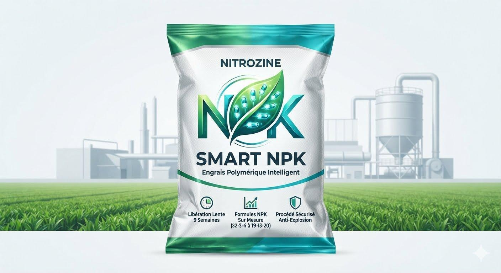

# MOHAMED MAKNI
### **Serial Entrepreneur & R&D Specialist / Inventor**
📍 Tunis, Tunisia | ✉️ maknifr@yahoo.fr

---

## 💼 PROFESSIONAL SUMMARY
Dynamic and visionary **Serial Entrepreneur and Prolific Inventor** with over 40 years of hands-on experience founding, managing, and scaling businesses across diverse sectors, including Hospitality, International Trade, Marketing, and Manufacturing. Passionate about **Research & Development (R&D)**, holding multiple national and international patents and copyrights in green energy, chemical engineering, and smart technologies. Proven track record of transforming innovative concepts into functional, industrial-grade solutions.

---

## 🛠️ AREAS OF EXPERTISE & CORE COMPETENCIES
* **Innovation & R&D:** Patent & Copyright Management, Chemical Formulations, Mechanical & Hydraulic Systems, Prototyping.
* **Business Leadership:** Serial Entrepreneurship, Joint Ventures & Partnerships, Strategic Business Planning, Team Leadership.
* **Trade & Operations:** International Commerce, Supply Chain & Distribution, Mass Marketing, Hospitality Management.

---

## 🧪 PATENTS & INNOVATIONS (R&D)
* **Founder & Lead Inventor** | *Geopac (Patent Management & IP Protection)* **(2026 - Present)**
* **Inventor** | *NITROZINE PK Granular Fertilizer* **(2026)**
  * Invented an eco-friendly, slow-release, and highly secure granular NPK fertilizer along with its automated custom manufacturing process.
* **Inventor** | *Domestic Gasoline Vapor Distribution System* **(2026)**
  * Developed a low-cost heating and cooking solution substituting natural gas with controlled gasoline vapor distribution for residential usage.
* **Inventor** | *Negative Pressure Borehole Water Pumping System* **(2021)**
  * Designed an electricity-free deep well water extraction system leveraging natural negative pressure.
* **Inventor** | *Gasoline Vapor Power Generator* **(2020)**
  * Engineered an alternative internal combustion generator powered by optimized gasoline vapor extraction.
* **Inventor** | *Closed-Loop Hydraulic Power Generation System* **(2015 - 2019)**
  * Conducted R&D on clean electricity production utilizing a proprietary pressurized closed-loop water circuit.
* **Co-Inventor** | *NITROZINE Non-Explosive Nitrogen Fertilizer* **(2014)**
  * Co-developed a groundbreaking, non-explosive, and non-flammable ammonium nitrate-based fertilizer, securing national and international patents.

---

## 🚀 ENTREPRENEURIAL EXPERIENCE (HIGHLIGHTS)
* **Managing Director** | *Gagnant (Advertising & Marketing Agency)* **(2007 - 2014)**
* **General Manager & Consultant** | *Bureaux d’étude (Hammam Sousse)* **(2006 - 2012)**
* **Commercial Director** | *AGCC - African Gulf Commercial Cooperation (Tunis)* **(1997 - 1999)**
* **Founder & Owner** | *Industrial & Craft Manufacturing Units (Tunis/Sfax)* **(1980 - 1991)**
  * Founded and managed an *Industrial Painting Firm*, a *Leather Goods Factory*, and a *Slate Manufacturing Unit*.

---

## 🎓 EDUCATION & FORMAL TRAINING
* **Professional Certification: International Trade** | Netherlands *(1994 - 1996)*
* **Diploma: Fashion Design & Leather Goods** | CNCC Megrine *(1990)*
* **Professional Training: Sales Force** | Paris, France *(1989 - 1990)*
* **High School Diploma: Mathematics & Sciences** | Sfax & Tunis *(1981 - 1989)*

---

## 🌐 LANGUAGES
* **Arabic:** Native
* **French:** Fluent
* **English:** Professional Working Proficiency

